<picture>
  <source media="(prefers-color-scheme: dark)" srcset=".github/readme/banner-dark.svg" />
  
</picture>

<p align="center">
  <a href="https://github.com/LEN5010/AsoulTappo/releases/latest"></a>
  
  
  <a href="LICENSE"></a>
</p>

<p align="center">
  <a href="https://github.com/LEN5010/AsoulTappo/releases/latest"><b>下载</b></a> ·
  <a href="https://len5010.top/download?app=tappo">国内下载</a> ·
  <a href="https://github.com/LEN5010/AsoulTappo/issues">反馈</a>
</p>

AsoulTappo 是一款为枝江开发的开源联机桌宠软件

## 下载

在 [Releases](https://github.com/LEN5010/AsoulTappo/releases/latest) 页面下载对应平台的文件；无法访问 GitHub 时，可在 [len5010.top/download](https://len5010.top/download?app=tappo) 下载相同的文件。

| 平台 | 文件 | 说明 |
| --- | --- | --- |
| Windows（x64） | `_x64-setup.exe` | NSIS 安装器，未经 Microsoft 签名；SmartScreen 拦截时选择仍要运行 |
| macOS 10.15+ | `_universal.dmg` | 通用包，支持 Apple 芯片和 Intel；未经 Apple 公证 |

macOS 首次打开如提示已损坏或无法验证开发者，将应用拖入应用程序文件夹后在终端执行：

```sh
xattr -dr com.apple.quarantine /Applications/AsoulTappo.app
```

键鼠响应需要在系统设置的隐私与安全性 → 输入监控或辅助功能中允许 AsoulTappo，任选一项即可，允许后重启桌宠。开关已打开但桌宠仍不响应时，在列表中用减号删除 AsoulTappo 后重新添加：1.1.2 及更早的版本每次更新后都需要这样做，之后的版本使用固定签名，只在第一次更新后需要。

## 功能

| | |
| --- | --- |
| 桌宠 | 五位成员与 12 款皮肤。键盘输入、鼠标移动动画支持窗口置顶和点击穿透。 |
| 手柄 | Windows 支持 Xbox 及 XInput 兼容手柄。Windows 和 macOS 支持 DualShock 4、DualSense 和 DualSense Edge 的 USB、蓝牙输入，按键和扳机可在游戏全屏时驱动桌宠并累计敲击。 |
| 同桌联机 | 通过房间号加入，单个房间最多 20 人。其他成员的桌宠显示在本机桌面，位置可拖动。可以戳一戳伙伴的桌宠，也可以选一个状态（摸鱼、工作、学习、打游戏、听歌、看直播）显示给同房间的人；同一房间的成员一起敲满应援条，每人获得碎片。 |
| 排行 | 个人主页展示铭牌、收藏进度和 3 张展示卡；全服收藏榜按收藏分排名（大隐藏、皮肤、卡片和表情按获得难度计分），可在设置里关闭上榜。 |
| 收集 | 495 个表情（27 套）与 85 张卡片，其中 33 张为动态卡。背包用于选择角色、皮肤和 8 个常用表情。 |
| 刮刮乐 | 每天 20 张，每张 500 碎片，奖品为碎片或阿草表情（5%，10 张保底），20 个阿草表情只在这里获得，集齐解锁阿草铭牌，之后只出碎片。 |
| 猜拳 | 在房间里邀请其他成员石头剪刀布，下注 150、1500 或 15000 碎片，赢家拿 250、2500 或 25000；双方都需累计敲击满 1 万，每天净赢最多 1 万。输家的桌宠头上贴 5 分钟阿草贴纸。设置里可开免打扰。 |
| 账号 | 支持 Asasfans 账号登录，与 Asasfans Web、Asasfans Next 共用同一账号。 |

使用 DS4Windows 等工具把 PS 手柄映射成 Xbox 手柄时，在 HidHide 中隐藏实体手柄，并将映射工具加入允许访问的应用列表。桌宠通过 XInput 读取映射后的输入，同一次按键计数一次。[HidHide 配置说明](https://github.com/nefarius/HidHide#user-guide)

<details>
<summary>此间共鸣的概率与碎片规则</summary>

五位成员共用一个卡池，每次共鸣消耗 160 碎片。

| 结果 | 概率 | 保底 |
| --- | --- | --- |
| 大隐藏 | 0.1% | 400 次 |
| 皮肤 | 0.2% | 200 次 |
| 小隐藏与跳舞卡 | 4.5% | |
| 稀有表情 | 3% | |
| 罕见表情 | 6% | |
| 普通卡 | 45% | |
| 普通表情 | 41.2% | |

两项保底分别计数。重复的物品自动兑换成碎片：表情 5，普通卡和跳舞卡 20，小隐藏 360。小隐藏与跳舞卡集齐后这一档仍保留 4.5%，出的都是重复。

新用户获得 1600 碎片。碎片来自敲击，按当天计入的敲击数累计发放，越往后每下给得越少：1 万下 9000 碎片，2 万下 13000，3 万下 16000，之后逐渐接近每天 18000 的上限（约 4.9 万下后每下不到 0.01），北京时间零点重新计算。每分钟最多计入 120 下。挂机不给碎片。

</details>

## 自建服务端

客户端默认连接官方服务器 `https://len5010.top/tappo`，可在设置中改为其他地址。`deploy/` 提供 Docker Compose 配置，同时启动服务端和负责 HTTPS 的 Caddy：

```sh
cd deploy
DOMAIN=tappo.example.com docker compose up -d --build
```

未设置 `MAIN_API_URL` 的服务端不提供 Asasfans 账号登录，仅支持游客存档。

## 从源码构建

客户端使用 Tauri 2、Vue 3 和 TypeScript，需要 [Node.js 20+](https://nodejs.org/)、[Rust](https://rustup.rs/) 及对应平台的 [Tauri 依赖](https://tauri.app/start/prerequisites/)。服务端使用 FastAPI，需要 Python 3.12。

```sh
# 服务端
cd server
python -m venv .venv && . .venv/bin/activate
pip install -r requirements-dev.txt
pytest -q
uvicorn app.main:app --port 8000

# 客户端
cd client
npm install
npm run tauri dev
npm test
```

<details>
<summary>打包、发版与目录结构</summary>

`npm run tauri build` 在 Windows 上生成 NSIS 安装器，在 macOS 上生成 `.app` 和 `.dmg`。配置启用了更新包签名，本地没有 `TAURI_SIGNING_PRIVATE_KEY` 时需加 `--no-sign`。

推送 `v*` 标签会触发 Release workflow：先构建 Windows 安装器，再构建 macOS 通用 DMG，两者写入同一个 Release 并更新 `latest.json`。标签需与 `client/src-tauri/tauri.conf.json` 中的版本一致。

| 目录 | 内容 |
| --- | --- |
| `client/` | 客户端；`src-tauri/` 包含全局键鼠钩子、托盘和透明覆盖层窗口 |
| `server/` | 房间与存档服务，SQLite 存储 |
| `assets-packs/` | 服务端提供下载的高清卡面与主题素材 |
| `scripts/` | 素材压缩与 manifest 生成 |
| `protocol/` | HTTP 与 WebSocket 协议 |
| `deploy/` | Docker Compose 与 Caddy 配置 |

相关文档：[素材构建](ASSETS.md)、[协议](protocol/PROTOCOL.md)、[架构](docs/ARCHITECTURE.md)。

</details>

## 致谢

角色皮肤由画师 [神秘三文鱼_](https://space.bilibili.com/2061322519) 绘制。

界面字体使用 [Noto Sans SC](https://github.com/notofonts/noto-cjk) 和 [Barlow](https://github.com/jpt/barlow)，均以 SIL Open Font License 1.1 授权。

五位成员的基础桌宠素材来自 [Evelynall/ASoul-Little-Bun](https://github.com/Evelynall/ASoul-Little-Bun)，已获作者许可。

## 反馈

问题反馈和功能建议请提交到 [GitHub Issues](https://github.com/LEN5010/AsoulTappo/issues)。

## 声明与许可证

AsoulTappo 是非官方粉丝项目，与 A-SOUL 及相关公司没有官方关联。A-SOUL 标志和角色美术的版权归 A-SOUL 所有，不在本项目的许可范围内。

本项目代码基于 GNU General Public License v2.0 发布，详见 [LICENSE](LICENSE)。

使用官方联机服务前需要同意[用户协议](client/src/legal/terms.md)和[隐私政策](client/src/legal/privacy.md)。
